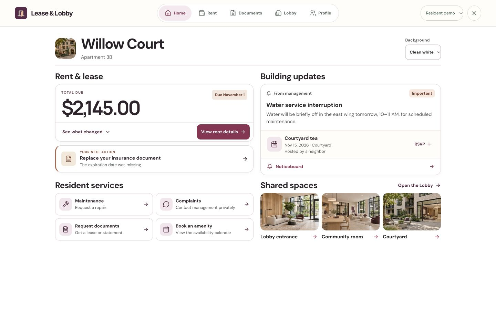

# Lease & Lobby

A resident portal prototype by Pooja Hegde.

## Why I built it

I built Lease & Lobby to give apartment residents one place for routine tasks and building updates. A resident can review a rent charge, request a repair or document, contact management privately, or check whether a shared space is available.

## Who it’s for

It’s designed for apartment communities and leasing teams. Residents can see what needs their attention and check the status of requests. Staff can handle those requests and publish notices from a building workspace.

## Management feedback

I spoke with my apartment management about the idea. They liked the design and the concept, and our conversations are ongoing. The project is a prototype and building adoption has not been measured.

## What to try

- Review the sample rent statement and see why the total changed.
- Submit a repair request with one of four priority levels, request a lease document, or send a fictional complaint. Switch to Manager demo to respond to the complaint.
- Check the party room, pool, or BBQ availability and make a sample reservation.
- Explore the building’s shared spaces and RSVP to a fictional event.

The public demo uses the fictional Willow Court property and runs in the browser. Payments are simulated. The private portal requires separately configured authentication, storage, and a database.

## Source and local development

Download [lease-and-lobby-source.zip](lease-and-lobby-source.zip) and extract it. Open `LOCAL-DEVELOPMENT.md` for Node and pnpm setup. The archive includes the React/Vite app, Express API, and PostgreSQL schema. It excludes environment files and real resident records.
